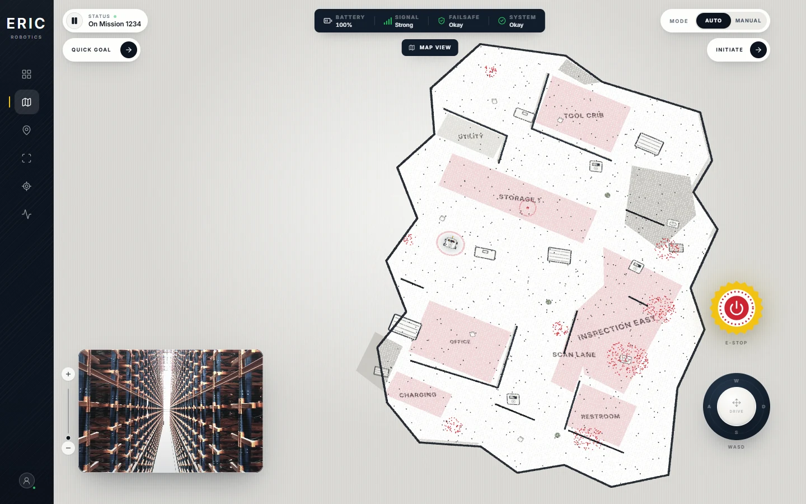
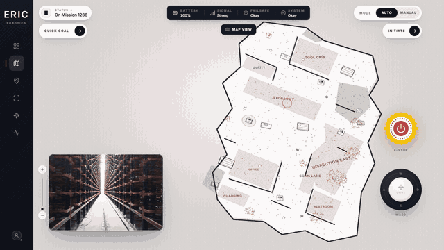

# Insight.IO — ERIC Robotics Dashboard

A self-hosted recreation of the ERIC Robotics **Insight.IO** mission-control dashboard. The app combines a procedural 3D point-cloud map, a local camera feed, live telemetry over Server-Sent Events (SSE), autonomous goal routing, manual driving, and emergency-stop controls.



## Submission

- **Name:** Aliasgar Imdad Bootwala
- **Contact number:** +91 94226 42153
- **Email:** aliasgarbootwala3@gmail.com
- **GitHub:** [1129Aliasgar](https://github.com/1129Aliasgar)
- **LinkedIn:** [linkedin.com/in/aliasgar-bootwala-22b4a8308](https://linkedin.com/in/aliasgar-bootwala-22b4a8308)

## Demo

The demo shows the map view, live mission telemetry, the camera/map picture-in-picture swap, and the responsive layout.



- [Watch the MP4 demo](docs/demo.mp4)
- [Desktop camera view](docs/screenshots/desktop-camera.webp)
- [Mobile map view](docs/screenshots/mobile-map.webp)
- [Mobile camera view](docs/screenshots/mobile-camera.webp)

## Features

- **Interactive 3D map** built with Three.js from a generated `.pcd` point cloud, with zone labels, walls, furniture, goal markers, route lines, pan/zoom/tilt, and optional scan sweep.
- **Camera/map swap** with an animated picture-in-picture card, matching the supplied design.
- **Live telemetry** over SSE: battery, signal, failsafe/system health, mission progress, ETA, pose, velocity, odometer, and route.
- **Mission controls:** quick-goal modal, start/initiate, pause/resume, auto/manual mode, and six preset goals.
- **Manual driving** with an analog joystick or `WASD`; the backend enforces auto/manual safety rules.
- **Emergency stop lifecycle:** E-stop, confirmation modal, reset to paused, then resume. The modal reads the live mission ID rather than a hard-coded value.
- **Responsive UI:** desktop rail becomes a mobile bottom navigation; the map reframes for portrait and picture-in-picture layouts.
- **Local-first:** bundled Inter font, local video, local point cloud, procedural textures. No runtime CDN, map tile, or external API dependency.
- **Accessibility:** labelled controls, keyboard shortcuts, focus states, `aria-live` notifications, reduced-motion support, and a visible focus path.

## Tech stack

| Layer    | Tools                                                                 |
| -------- | --------------------------------------------------------------------- |
| Frontend | React 19, TypeScript, Vite, Tailwind CSS 4, Motion, Three.js, Zustand |
| Backend  | Node.js, Fastify, Zod, Server-Sent Events                             |
| Tooling  | npm workspaces, Vitest, Playwright, ESLint, Prettier, tsup            |
| Assets   | Generated binary PCD, local H.264 camera clip, self-hosted Inter      |

## Quick start

**Prerequisites:** Node.js `>=20.19` (Node 22 LTS recommended; tested on Node 24.14.1) and npm.

```bash
npm install
npm run dev
```

Open **http://localhost:5173**. The API runs at **http://127.0.0.1:4000** and Vite proxies `/api`.

For the production-style local server:

```bash
npm run build
npm start
```

Open **http://127.0.0.1:4000**. Fastify serves the built SPA and the API from the same origin.

> The app is offline after `npm install`. All fonts, icons, map data, and media are bundled in the repo.

## Controls

- **Click the camera card** to make camera the main view; click the map PiP to swap back.
- **V** toggles camera/map view.
- **Q** opens the quick-goal picker.
- **Space** pauses/resumes the mission.
- **M** toggles auto/manual mode.
- **WASD** or the on-screen joystick drives in manual mode.
- **Esc** closes a modal or drawer.
- The E-stop opens a reset confirmation. Reset leaves the mission paused; resume explicitly restarts it.

## Project structure

```text
.
├─ apps/
│  ├─ web/                 React dashboard
│  │  ├─ src/components/   HUD, views, map, controls, modals, panels
│  │  ├─ src/hooks/        telemetry, commands, driving, hotkeys
│  │  ├─ src/lib/          Three.js engine, API client, helpers, tests
│  │  ├─ src/store/        dashboard, UI, toast state
│  │  └─ public/           PCD map, camera video, poster
│  └─ server/              Fastify API + robot simulator + tests
├─ packages/
│  └─ shared/              Types, Zod schemas, floor plan, A* navigation
├─ e2e/                    Playwright dashboard flows
├─ scripts/                PCD generator, media capture
└─ docs/                   Approach notes, screenshots, demo, credits
```

## Architecture

```
Browser (React + Three.js + Zustand)
   │  REST commands             ▲ SSE telemetry
   ▼                            │
Fastify API ──────────────── RobotSimulator
   │                            │
   └── static SPA build         └── route planner (shared A*)
```

- `@insight/shared` owns the facility geometry, goal definitions, navigation graph, A* planner, and request/response schemas so client and server agree on one source of truth.
- The server simulates pose, speed, battery, route progress, mission lifecycle, and safety state at 10 Hz. Every state change is pushed to subscribers and broadcast over `/api/telemetry/stream`.
- The frontend keeps a Zustand snapshot, applies SSE frames, animates between poses, and renders the map in an imperative Three.js engine. React owns UI; Three.js owns the render loop.
- The PCD is loaded and parsed client-side, then rendered as a point cloud. Walls, floors, zone fills, labels, furniture, robot, and goal markers are generated procedurally in the browser.
- The camera is a locally bundled clip presented through a responsive `<video>` element. The map and camera views share the same animated view stack, so the PiP is the real live component rather than a static thumbnail.

See [docs/APPROACH.md](docs/APPROACH.md) for the design and implementation rationale.

## API

| Method | Route                   | Purpose                         |
| ------ | ----------------------- | ------------------------------- |
| GET    | `/api/health`           | Service health                  |
| GET    | `/api/state`            | Current telemetry snapshot      |
| GET    | `/api/telemetry/stream` | SSE telemetry stream            |
| POST   | `/api/mission/goal`     | Retarget the active mission     |
| POST   | `/api/mission/initiate` | Start a new mission             |
| POST   | `/api/mission/pause`    | Pause the active mission        |
| POST   | `/api/mission/resume`   | Resume a paused mission         |
| POST   | `/api/robot/mode`       | Switch `auto` / `manual`        |
| POST   | `/api/robot/velocity`   | Set manual linear/angular speed |
| POST   | `/api/emergency/stop`   | Trigger the emergency stop      |
| POST   | `/api/emergency/reset`  | Reset E-stop, leave paused      |

Errors use a stable shape: `{ error: { code, message, requestId } }`. Payloads are validated with Zod.

## Tests

```bash
npm run lint
npm run typecheck
npm test              # shared, server, and web unit tests
npm run build
npm run verify        # lint + typecheck + unit tests + build
```

End-to-end tests use Playwright and exercise the live production server:

```bash
npx playwright install chromium
npm run test:e2e
```

The E2E suite covers map loading, camera/map swapping, keyboard view toggling, goal retargeting, the full E-stop/reset/resume flow, and a 390 px mobile viewport.

## Notes and trade-offs

- **Simulation instead of ROS:** this submission is self-contained and runs without ROS. The simulator and SSE boundary are deliberately isolated so a ROS 2 bridge could replace it without changing the UI.
- **Generated map instead of a dataset:** the PCD is generated from the same facility geometry used for routing, keeping map, labels, goals, and robot coordinates aligned. The generator is committed at `scripts/generate-pcd.ts`.
- **Camera footage:** the local warehouse clip is used as the camera feed. It is not a live robot stream. Credit is documented in [ASSET_CREDITS.md](ASSET_CREDITS.md).
- **Responsive framing:** the desktop map keeps the reference composition, while portrait and PiP layouts recenter the map to avoid cropping.
- **No authentication:** this is a local demo dashboard, not a multi-user deployment.

## Credits

Camera footage, fonts, icons, and library licenses are listed in [ASSET_CREDITS.md](ASSET_CREDITS.md).

---

Built for the ERIC Robotics Insight.IO UI/UX assignment.
